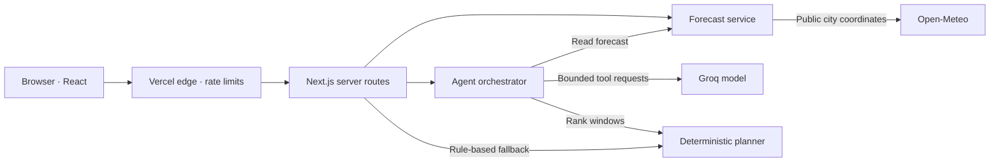

# Weather Window

A weather app with an assistant that finds the best forecast window for an outdoor activity.

| Release information | Value |
|---|---|
| Public app | _Fill in after the production smoke test._ |
| Source repository | _Fill in before submission._ |
| Deployed commit | _Fill in with the tested commit SHA._ |

This document describes the target implementation for the hiring exercise. The local commands below are the planned repository interface and must be checked against the implementation before submission.

## Try it

Select **Laval, Québec**, choose **Hiking**, pick a day within the forecast horizon and set the duration to two hours, precipitation probability to 30% and sustained wind speed to 25 km/h. The assistant evaluates live forecasts. The result may be a matching window, no match or insufficient forecast data. Automated tests use fixed forecasts to demonstrate each outcome consistently.

## Architecture

The React application and server routes share a Next.js deployment. The browser searches a bundled city catalogue. Server code owns the upstream provider integrations and recommendation logic.



The model receives validated activity criteria and the minimum public forecast data used by its tools. The server computes candidate windows and produces the structured response. Conditions and times shown in the interface come from the forecast and planner. Weather data is attributed to [Open-Meteo](https://open-meteo.com/).

## Run locally

Use the Node.js version pinned by the repository and the committed npm lockfile.

```bash
npm ci
cp .env.example .env.local
npm run dev
```

Open [localhost:3000](http://localhost:3000). The app should run with the rule-based planner without an AI key. Set `AI_ENABLED=true`, `GROQ_API_KEY` and `GROQ_MODEL` in `.env.local` to exercise the live agent.

```bash
npm run lint
npm run typecheck
npm test
npm run build
```

Use fixed fixtures for CI and the live deployment for an end-to-end smoke test. See [Product specification](docs/product-spec.md) for acceptance criteria, [Deployment](docs/deployment.md) for release and incident procedures, and [Claude Code instructions](CLAUDE.md) for AI-assisted changes.
