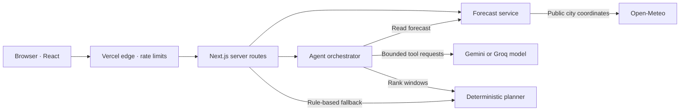

# Weather Window

A weather app with an assistant that finds the best forecast window for an outdoor activity.

Fill in the table below after the production checks in [Deployment](docs/deployment.md#release-record); `npm run check:release` fails until it is complete.

| Release information | Value |
|---|---|
| Public app | https://weather-use-case-rho.vercel.app |
| Source repository | https://github.com/osanas/weather-use-case |
| Deployed commit | `29f84ee` (production, verified 2026-11-24) |

This document describes the target implementation for the hiring exercise. The local commands below are the planned repository interface and must be checked against the implementation before submission.

## Try it

Select **Laval, Québec**, choose **Hiking**, pick a day within the forecast horizon and set the duration to two hours, then select **Find best time**. The server applies the comfort limits for the activity (hiking: at most 30 % precipitation probability and 30 km/h sustained wind) and evaluates live forecasts. The result may be a matching window, no match or insufficient forecast data, labelled AI-assisted or rule-based. Automated tests use fixed forecasts to demonstrate each outcome consistently.

## Architecture

The React application and server routes share a Next.js deployment. The browser searches a bundled city catalogue. Server code owns the upstream provider integrations and recommendation logic.



The model receives validated activity criteria and the minimum public forecast data used by its tools. The server computes candidate windows and produces the structured response. Conditions and times shown in the interface come from the forecast and planner. Weather data is attributed to [Open-Meteo](https://open-meteo.com/).

## Run locally

Use the Node.js version pinned by the repository and the committed npm lockfile.

```bash
npm ci
cp .env.example .env.local
npm run dev
```

Open [localhost:3000](http://localhost:3000). The app runs with the rule-based planner without an AI key.

### Configure the AI agent

The agent is optional and uses one provider: Google Gemini or Groq. It runs only when `AI_ENABLED=true` and the selected provider has a key and a model; otherwise the app stays rule-based.

| Variable | Value | Where to get it |
|---|---|---|
| `AI_ENABLED` | `true` to use the agent, `false` (default) for rule-based only | — |
| `AI_PROVIDER` | Optional: `gemini` or `groq`. When empty, Gemini is used if both `GEMINI_*` values are set, otherwise Groq | — |
| `GEMINI_API_KEY` | Your Gemini API key | [aistudio.google.com/apikey](https://aistudio.google.com/apikey) |
| `GEMINI_MODEL` | A Gemini model id that supports function calling | [Gemini models](https://ai.google.dev/gemini-api/docs/models) |
| `GROQ_API_KEY` | Your GroqCloud API key, starting with `gsk_` (not an xAI Grok key) | [console.groq.com/keys](https://console.groq.com/keys) |
| `GROQ_MODEL` | A Groq model id that supports tool calling | [Groq tool use](https://console.groq.com/docs/tool-use) |

1. Copy `.env.example` to `.env.local` (already ignored by Git), set `AI_ENABLED=true` and fill in the key and model of one provider.
2. Restart `npm run dev`. A planning result labelled **AI-assisted recommendation** confirms the agent path; **Rule-based recommendation** means the fallback was used.
3. Never commit `.env.local`, never prefix these variables with `NEXT_PUBLIC_`, and never paste a key into an issue, PR or chat. Gitleaks scans every pull request for leaked secrets.

For Vercel, set the same variables per environment as described in [Deployment](docs/deployment.md#where-to-set-each-value).

```bash
npm run lint
npm run typecheck
npm test
npm run build
```

Use fixed fixtures for CI and the live deployment for an end-to-end smoke test. See [Product specification](docs/product-spec.md) for acceptance criteria, [Deployment](docs/deployment.md) for release and incident procedures, and [Claude Code instructions](CLAUDE.md) for AI-assisted changes.

## Delivery workflow

Track work in Linear, link the ticket to a GitHub pull request, run the Verify check and review the Vercel preview before merging. The [team workflow](docs/team-workflow.md) contains setup instructions, the initial backlog and the Playwright contracts.

Every pull request runs CI (lint, typecheck, unit and browser tests, build) and security scans: Gitleaks for secrets, OSV-Scanner and Trivy for vulnerable dependencies and misconfiguration, and actionlint for the workflows. OWASP ZAP scans the deployed site weekly and Dependabot proposes updates. The [use-case presentation](docs/use-case-presentation.md) explains each check and includes the architecture, planning and workflow diagrams.
