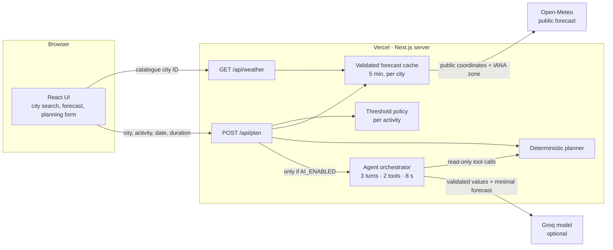
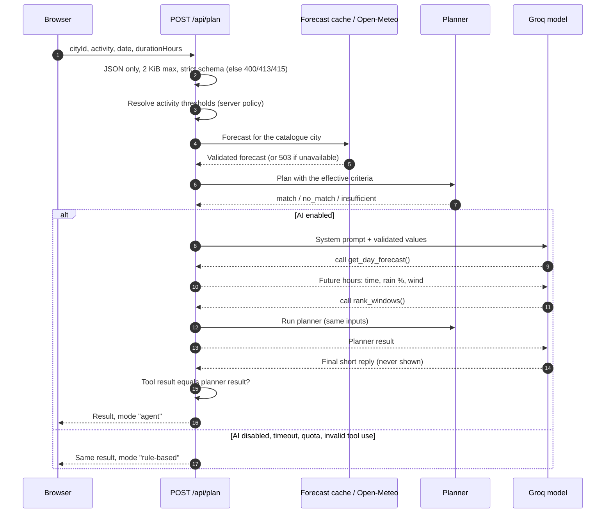
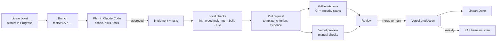
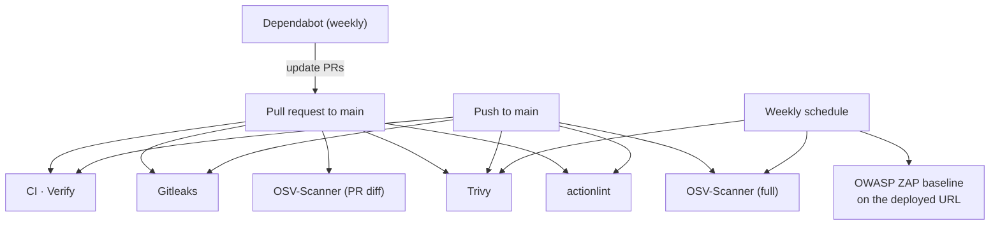

# Weather Window | Use-case presentation

A presentation guide for the hiring exercise: what the app does, how it is built, how the work was delivered, and which automated checks protect it. Diagrams use Mermaid and render on GitHub.

## 1. The use case in one minute

**Problem.** People planning a hike, a bike ride or a walk read an hourly forecast and guess when conditions will be acceptable.

**Solution.** Weather Window shows the forecast for a Canadian city and answers one question: *what is the best time on this day for my activity?*

- The visitor picks a city, an activity, a date and a duration (one to four hours). Nothing else: no account, no location, no free text.
- The server applies fixed comfort limits for the activity and finds the best eligible window with a deterministic planner.
- An AI agent (Groq) can be enabled to orchestrate the same planner through read-only tools. If the model is slow, over quota or behaves unexpectedly, the app returns the same rule-based answer.

| Activity | Max precipitation probability | Max sustained wind |
|---|---|---|
| Cycling | 20 % | 20 km/h |
| Hiking | 30 % | 30 km/h |
| Walking | 40 % | 35 km/h |

The rationale for these values is in [the product specification](product-spec.md#default-activity-thresholds).

## 2. Architecture

The React interface and the server routes share one Next.js deployment on Vercel. Provider calls and credentials stay on the server.

**Key design choices**

- **City search is local.** The browser filters a bundled catalogue; keystrokes never leave the page. Every API request uses a catalogue ID that the server validates.
- **Time zones come from the provider.** Local days are bounded by Open-Meteo's local-midnight instants for the city's IANA zone, so daylight-saving changes (23- and 25-hour days) and outdated server time-zone data cannot shift a window.
- **The planner is the source of truth.** Every window shown comes from the planner. The agent can only request two tools, and its result must equal the planner result to be labelled "AI-assisted".
- **Thresholds are server policy.** The form has no threshold fields, and the API rejects any threshold sent by a client.

## 3. Planning request, agent and fallback

Rejected agent behaviours, each tested with a fake model: an unknown tool, a call with arguments (for example an attempt to change the city or thresholds), ranking before the forecast, repeated or parallel calls, more than two tool calls, a proposal without a tool result, a timeout, a quota error and invalid output.

## 4. Delivery workflow

Each Linear ticket follows the same path. Plans are approved before code changes, and the maintainer pushes, merges and releases.

**Ticket history**

| Ticket | Outcome | Status |
|---|---|---|
| WEA-5 | Next.js vertical slice: current Laval weather from Open-Meteo | Done |
| WEA-11 | Security scanners in GitHub Actions | Done |
| WEA-6 | City search, hourly and five-day forecasts, time zones | Done |
| WEA-7 | Deterministic planner, DST-safe local days | Done |
| WEA-8 | Planning form and results view, `POST /api/plan` | Done |
| WEA-12 | Approved default thresholds per activity | Done |
| WEA-9 | Bounded Groq agent with rule-based fallback | In Review |
| WEA-10 | Harden and verify the production demo (rate limits, privacy notice, release record) | Todo |
| WEA-13 | Conversational guide for the planning form | In Progress |

## 5. GitHub Actions and automated checks

| Check | When it runs | What it does | Why it matters | A failure means |
|---|---|---|---|---|
| **CI · Verify** (`ci.yml`) | Every PR, push to `main` | `npm ci`, ESLint, TypeScript, Vitest unit and integration tests, `next build`, Playwright browser tests. Runs with `AI_ENABLED=false` and no keys. | Proves the app builds and behaves as specified with synthetic fixtures; it is the required status check. | A regression, type error, lint error or broken user journey. |
| **Gitleaks** (`gitleaks.yml`) | PR, push to `main`, manual | Scans the full Git history for committed secrets (API keys, tokens), with redacted output. | A key pushed once stays in history; this catches it before it spreads. | A secret-like value was committed: revoke and rotate the key, then clean history. |
| **OSV-Scanner** (`osv-scanner.yml`) | PR (new vulnerabilities only), push to `main`, weekly, manual | Checks `package-lock.json` against the OSV database of known vulnerabilities and uploads results to GitHub code scanning. | Catches vulnerable npm dependencies, including ones disclosed after the code was written. | A dependency has a known vulnerability: update or assess it. |
| **Trivy** (`trivy.yml`) | PR, push to `main`, weekly, manual | Scans the repository files for HIGH or CRITICAL vulnerable dependencies and misconfigurations. | A second, independent view of dependencies plus configuration issues. | A high-severity finding to fix or justify. |
| **actionlint** (`actionlint.yml`) | PR, push to `main`, manual | Lints the workflow files themselves (syntax, expressions, shell). | Broken or unsafe workflows silently weaken every other check. | A workflow file is invalid or risky. |
| **OWASP ZAP baseline** (`zap-baseline.yml`) | Weekly, manual | Passive scan of the deployed site (missing security headers, cookie flags, information leaks). The target comes from the `ZAP_TARGET_URL` repository secret or a manual input. Reports without failing the run. | Tests what is actually deployed, not just the code. | Findings to review in the run report. |
| **Dependabot** (`dependabot.yml`) | Weekly | Opens PRs to update npm packages and GitHub Actions versions. | Keeps dependencies current; each update goes through all checks above. | — |

All workflows use read-only permissions by default, `persist-credentials: false` on checkout, pinned tool versions and timeouts. Only OSV-Scanner may write security events.

## 6. Security and privacy controls

| Risk | Control in the code | Evidence |
|---|---|---|
| Secret exposure | Keys only in server environment variables; `.env.local` is ignored by Git; no `NEXT_PUBLIC_` key; the client bundle is checked for provider strings | Gitleaks, build review, tests using placeholder keys |
| Untrusted input | Strict schemas, 2 KiB body limit, JSON only, catalogue city IDs, unknown fields rejected | API tests for 400, 413 and 415 |
| Untrusted model output | Two read-only tools with no arguments, fixed endpoints, limits on turns, calls and time; model text never rendered | Agent tests with a fake model |
| AI outage | Rule-based fallback; weather unaffected; `AI_ENABLED=false` kill switch | Fallback tests, including a timeout at the server boundary |
| Personal data leaving the app | No accounts, geolocation or free text; providers receive public coordinates or validated values only; no IP or browser headers forwarded | Outbound payload tests |
| Logs | Allowlisted fields only: route, status category, outcome, elapsed time | Handler tests on log keys |
| Abuse of a public endpoint | Vercel firewall rate limit on `/api/plan` (WEA-10) | Deployed rate-limit test (pending) |

## 7. Configuration and keys

| Value | Local development | Vercel | GitHub |
|---|---|---|---|
| `AI_ENABLED` | `.env.local` | Project environment variable (Preview: `false`) | CI sets `false` |
| `GROQ_API_KEY` | `.env.local` | Production (and an AI-enabled preview, if needed) | Never |
| `GROQ_MODEL` | `.env.local` | Same environments as the key | Never |
| `ZAP_TARGET_URL` | — | — | Repository secret, used by the ZAP workflow |

Setup steps are in the [README](../README.md#configure-the-ai-agent) and the [deployment specification](deployment.md#where-to-set-each-value).

## 8. Suggested demo script

1. **Forecast.** Open the app: Laval's current conditions, the next 24 hours and five days, all in Laval time. Switch to Vancouver with the keyboard to show local search and the time-zone change.
2. **Plan.** Choose Hiking, tomorrow, two hours, and select *Find best time*. Show the window in local time, the forecast values, the constraints used and the explanation.
3. **Activity matters.** Repeat with Cycling: stricter limits can turn a match into *No time meets these limits*.
4. **AI and fallback.** With `AI_ENABLED=true`, the result is labelled *AI-assisted recommendation*. Set it to `false` (or break the key) and redeploy: the same window appears as *Rule-based recommendation*, and the forecast keeps working.
5. **Quality gates.** Open a pull request: show the Verify check, the security scans, the Vercel preview and the Linear link.

## 9. Known limits and next steps

- Comfort limits ignore gusts, temperature, precipitation type and daylight, so night hours can be recommended.
- The forecast cache is per server instance.
- Displayed hour labels use the browser's time-zone data; a browser with outdated data can show a one-hour label shift for British Columbia (the instant itself is correct).
- Still to do in WEA-10: rate limits, privacy notice, release record and the live AI smoke test.
